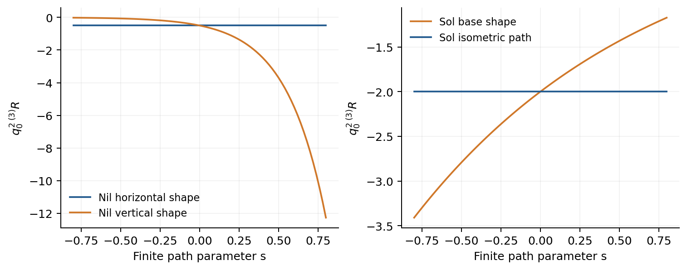
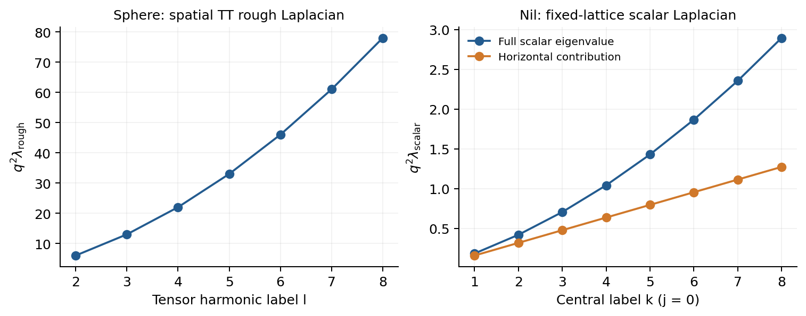

# 付録E. 幾何学的比較資料

この付録は、本文の拘束計数・wave解析で用いる幾何データを整理する。閉形式と固定商の扱いはPaper04、frame比較はPaper06、Nilの整数調和形式による有限計量の区別はPaper03EC、Solのisometric pathはPaper04に対応する[paper3ec](REFERENCES.md#paper3ec), [paper4](REFERENCES.md#paper4), [paper6](REFERENCES.md#paper6)。ここでは同じ格子・半径・作用規格化で式をまとめる。

## 閉1形式とframe表示

式(G-02)。

$$
\alpha=v_i\sigma^i,\quad v_i\ \text{constant}:\qquad d\alpha=0\ \Longleftrightarrow\ nv=0.
$$

指定した不変coframeでは定数係数閉1形式の次元は3−rank nである。コンパクトなunimodular商ではこれらは余閉でもある。標準Nilおよび完全可解Solでは不変形式が1次cohomologyを計算し、T³、S³と合わせてb₁=3/2/1/0となる[Nomizu1954](REFERENCES.md#nomizu1954), [Hattori1960](REFERENCES.md#hattori1960)。任意のframeの定数係数形式にこの同定を拡張しない。

固定商のb₁は格子のabelianizationからも確認できる。Nilではxとyの格子生成元のcommutatorがcentral生成元であり、実abelianizationはx,yの二次元となる。Solではbaseの一生成元とfiberのA−Iによるcoinvariantを取るが、Aは固有値1を持たないためfiberの実部分は零で、b₁=1となる。T³のb₁=3、simply connected S³のb₁=0と合わせ、指定coframeの閉形式がこの四商で全H¹を表す。

Paper06 §7・付録Aのflat torusの例を、本稿の規約で記す。

式(G-03)。

$$
\begin{aligned}\sigma^1&=\cos(\nu z)\thinspace dx+\sin(\nu z)\thinspace dy,\\
\sigma^2&=-\sin(\nu z)\thinspace dx+\cos(\nu z)\thinspace dy,\qquad \sigma^3=dz,\quad \nu\in\mathbb Z\setminus\lbrace 0\rbrace ,\\
\sum_i(\sigma^i)^2&=dx^2+dy^2+dz^2,\qquad n=\mathrm{diag}(-\nu,-\nu,0).\end{aligned}
$$

周期2πの同じflat torus上で、座標frameのrank 0と式(G-03)のrank 2が実現する。定数閉形式数は3と1だがb₁=3は不変である。たとえばdx、dyを新frameへ写すと空間依存係数を持つ。この比較は同じ場のlocal frame gauge変換と、各frameで定数成分だけを取る異なる切断を区別する。一定SO(3)共役のrank不変性はそのまま成立する。

## 固定商の有限計量path

式(G-04)。

$$
g=q_0^2\thinspace \mathrm{diag}(e^{2\beta_1},e^{2\beta_2},e^{2\beta_3}),\qquad \sum_i\beta_i=0.
$$

式(GE-03)。

$$
\begin{aligned}e&=E\sigma,\quad E=q_0\thinspace \mathrm{diag}(e^{\beta_i}),\quad m=EnE^T/\det E,\\
\omega^0{}_i&=0,\qquad\omega^i{}_j=\epsilon_{kij}\left[\tfrac12(\mathrm{tr}m)\delta_{k\ell}-m_{k\ell}\right]e^\ell,\\
S(s)-S(0)&=c q_0^3\Delta\tau\thinspace [R(s)-R(0)].\end{aligned}
$$

式(GE-03)ではsを各静的計量の有限parameterとし、時間依存場とはしない。全て同じ格子・体積q₀³V_Σを使い、各pathのLC接続を明記した。torsionとNY currentは零、時間端点のextrinsic curvatureも零であるため、有限のproper-time区間Δτにおける作用差はscalar曲率差に比例する。connection方程式を満たすことと、metric真空方程式を満たすことは異なる。

| path | β | q₀²R |
| --- | --- | --- |
| T³ shape | $`(s/2,-s/2,0)`$ | 0 |
| Nil flat | $`(s/2,-s/2,0)`$ | $`-1/2`$ |
| Nil vertical | $`(-s/2,-s/2,s)`$ | $`-e^{4s}/2`$ |
| Sol base | $`(s/3,-s/6,-s/6)`$ | $`-2e^{-2s/3}`$ |
| Sol isometric | $`(0,s,-s)`$ | $`-2`$ |

Solの表はn₂₃=n₃₂=1のcoframeで記述する。Nil verticalとSol baseは全ての有限sで一次微分が非零で、path曲率を停留点のmassと解釈しない。Nil flatは曲率一定でも全shape勾配が零ではなく、真空modulusではない。Sol isometricは固定mapping torusへ降りるbase方向の流れによるisometryである。

式(GE-01)。

$$
\delta g=2q^2B,\quad B^T=B,\quad\mathrm{tr}B=0:\qquad \delta R=-\frac2{q^2}\mathrm{tr}(XB).
$$

式(GE-01)はscalar曲率式を直接微分したものに等しく、Nil・SolでX≠0であることから全shape方向の停留性がないと分かる。tracefree BのDeWitt normは正だが、停留していないpathのHessianを物理massに変えるものではない。

式(G-05)。

$$
\left(\left\langle\frac{dx}{2\pi},\frac{dx}{2\pi}\right\rangle,\left\langle\frac{dy}{2\pi},\frac{dy}{2\pi}\right\rangle\right)=\frac{\mathcal V_{\Sigma}q_0}{4\pi^2}(e^{-s},e^s).
$$

Nil flatではdx/(2π)、dy/(2π)が整数調和1形式の基底を与える。非零整数形式の最小二乗normは式(G-05)の共通係数×exp(−|s|)なので、異なる|s|のコンパクト計量はisometricではない。sと−sには離散的な同定があり得る。これは固定商での有限計量の区別であり、真空性や完全moduli分類を主張しない。

式(GE-02)。

$$
f_s(x,y,z)=(x+s,y,z),\qquad f_s^{\ast}\sigma=(\sigma^1,e^s\sigma^2,e^{-s}\sigma^3).
$$

このf_sはSolのfiber並進とmonodromy同定と可換で、固定compact quotientへ降りる。従ってSol isometric pathはf_s* g₀であり、見かけ上のshape方向を新しいmodulusと数えない。Nil flatの整数harmonic lattice invariantと対照的である。

固定商上の有限pathのscalar曲率。本文のmetric拘束に対する幾何学的比較資料。

## 比較用の幾何演算子

以下は指定した静的Riemannian計量の幾何演算子である。本文第6–7節の作用から導いたtorusの物理modeとは、演算子と背景条件を区別して記録する。

式(S-01)。

$$
\lambda_{\rm rough,TT}(S^3)=\frac{\ell(\ell+2)-2}{q^2},\qquad \ell\ge2,\qquad d_\ell=2(\ell-1)(\ell+3).
$$

式(S-01)はround S³のrank-2 TT tensorに対するrough Laplacianの固有値である[Allen1995](REFERENCES.md#allen1995)。scalar LaplacianやLichnerowicz演算子と同じではない。現モデルのstatic sphereはoff-shellなので、この値を物理的な振動数として採用しない。

式(S-02)。

$$
\begin{aligned}\lambda_{\rm tor}(\mathrm{Nil})&=(m^2+n^2)/q^2,\quad(m,n)\in\mathbb Z^2,\\
\lambda_{k,j}(\mathrm{Nil})&=q^{-2}\left[\frac{k^2}{4\pi^2}+\frac{|k|}{2\pi}(2j+1)\right],\quad k\ne0,\quad j\ge0.\end{aligned}
$$

Nilの式は付録Aの格子におけるscalar Laplacianである。符号付きkごとの縮退は|k|で、異なるラベル間の固有値の一致は別に合算する。central方向のk²項とhorizontal oscillatorの項を合わせた固有値となる[Andriot2018](REFERENCES.md#andriot2018)。

式(S-03)。

$$
L_{p_y,p_z}=q^{-2}\left[-\frac{d^2}{dx^2}+p_y^2e^{-2x}+p_z^2e^{2x}\right],\qquad L_{p_y,p_z}\ge\frac{2|p_yp_z|}{q^2}.
$$

Solでは各非零dual-lattice orbitに対して式(S-03)を用い、monodromyのorbit同定から定義域を定める[Bolsinov2006](REFERENCES.md#bolsinov2006)。boundはpotentialの算術幾何平均とkinetic項の非負性から従う。零orbitはbase circleの別sectorである。これらはscalar演算子の比較であり、選択した真空背景の結合重力演算子は第6節と付録F–Hで別途扱う。

sphereのTT rough LaplacianとNilのscalar Laplacian。各演算子の固有値を、本稿の半径・格子規約で示す。

[論文の入口](README_ja.md) / [参考文献](REFERENCES.md)
