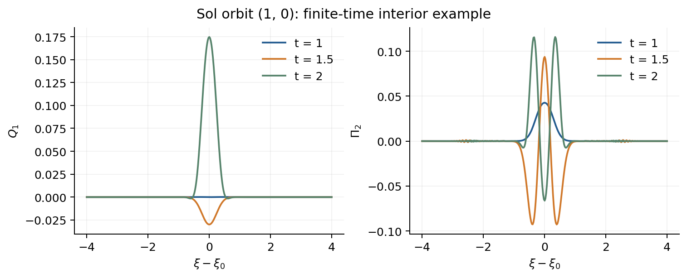

# 付録H. 有限時間例とSolの数値対照

## 有限blockの初期値と対照

Sol Gowdyではn=1とし、p=J₀(kt)、r=J₀(√(k²+4)t)/2の値と微分をt=1で与える。Nil baseでは波数(1,0)、P=√2 p cos x、Q=√2 q sin xとし、u=1で(p,pᵤ,q,qᵤ)=(0.2,0.07,−0.1,0.03)を与える。Hamiltonian初期momentumは作用N-01から換算する。

Nil centralではm=1,r=0,L=2でQ=0、Π=(0.03,−0.02)をu=1で与える。S³ではj=3/2の左m=+3/2にQ=0、八momentum中の第1成分0.03、第6成分−0.02をτ=1/4で与え、左m=−3/2の実場共役を加える。いずれも残る成分は零で、全右添字と再構成で生成されるmetric成分を保持する。

DOP853で相対許容誤差10⁻¹⁰と10⁻¹²、絶対許容誤差はその1/100を比較し、各区間の201時刻で対照する。下表は細かい許容誤差での最大成分差であり、厳密な誤差上界ではない。

| 例 | 独立対照 | 最大差 | 拘束 |
| --- | --- | --- | --- |
| Nil base | 二階対Hamilton | $`1.13\times10^{-12}`$ | $`3.89\times10^{-16}`$ |
| Nil central | 還元対全ADM | $`7.30\times10^{-13}`$ | $`6.94\times10^{-17}`$ |
| Sol Gowdy | 数値対Bessel | $`2.61\times10^{-12}`$ | 解析的再構成 |
| S³ Taub | 還元対全ADM | $`1.45\times10^{-13}`$ | $`2.22\times10^{-15}`$ |

Nil central chargeとS³の四chargeはこの初期値では零で、発展中も数値精度内で零である。これらの対照は線形有限時間例を裏付ける。これらの数値対照から厳密非線形族を構成したとはしない。Sol初期データの局所可積分性は、独立なSL-01の定理適用による。

## Solの独立4次元Lorenz系

式(SH-01)。

$$
\begin{aligned}
\mathcal F_\nu&=\nabla^\mu h_{\mu\nu}-\tfrac12\nabla_\nu h^\mu{}_\mu,\\
\delta R_{\mu\nu}-\nabla_{(\mu}\mathcal F_{\nu)}&=0,\qquad
H_{tt}=H_{\xi\xi}+B_xH_\xi+B_tH_t+B_0H.
\end{aligned}
$$

背景diag(−F,F,t,t)の非座標frameでRicciを直接変分してSH-01を得る。Lorenz gaugeによる標準的な双曲型還元を用いるが、WKB・幾何光学近似は行わない（[Andersson2021](REFERENCES.md#andersson2021)、§1.2・付録C）。十成分の順序は(00,01,02,03,11,22,33,12,13,23)、実係数化位相は(1,1,i,i,1,1,1,i,i,1)である。

式(SH-02)。

$$
\begin{aligned}
H_{00}(1)=H_{0i}(1)&=0,\quad (h,p)(1)=E(1)y(1),\\
\mathcal F(1)&=\dot{\mathcal F}(1)=0,\qquad
y=-J_rE^\dagger Jz,\quad (-J_rE^\dagger J)E=I,\\
(-J_rE^\dagger J)JC^\dagger&=0.
\end{aligned}
$$

空間HとḢを同じ拘束付きADM初期値へ合わせ、残るḢ₀₀,Ḣ₀ᵢをLorenz条件から決める。独立波動方程式とADM拘束からḞ(1)=0も厳密に確認する。SH-02のprojectionでgauge方向を消してから付録Gの還元変数yと比較し、異なるgaugeの生metric成分を等置しない。全B行列と初期写像はRG-01と直接Ricci変分を実装した公開補足に保存する。

式(SH-03)。

$$
\begin{aligned}
(n_1,n_2)&=(1,0),\quad \xi_0=\tfrac12\log(k_0/l_0),\\
y_\alpha(1,\xi)&=8^{1/4}\sum_{n=0}^{31}c_{\alpha n}
 \psi_n(\sqrt8(\xi-\xi_0)),\qquad \alpha=1,\ldots,4.
\end{aligned}
$$

128個の係数はdata/initial/sol_profile.jsonで固定し、hashを照合する。これは同一初期値の対照を定義する入力である。このprofileは固定した入力であり、保存物理modeや物理固有振動数とは解釈しない。ψₙは正規化Hermite関数であり、軌道と基底を時刻ごとに変えない。

## 固定離散化と三つの収束対照

式(SH-04)。

$$
\xi_j=\xi_0-W+\frac{2Wj}{N+1},\quad j=1,\ldots,N,\qquad
H(t,\xi)=\sum_{n=1}^N a_n(t)\sin\frac{n\pi(\xi-\xi_0+W)}{2W}.
$$

SH-04の時間固定sine基底で端点に斉次Dirichlet条件を課し、DSTで空間微分を計算する。これは拘束保存を保証する境界条件ではない。内部|ξ−ξ₀|≤4、1≤t≤2では連続方程式の特性速度1に対してW=5.25で0.25の余裕がある。非局所なspectral切断については別途幅の比較を行い、連続方程式の因果性だけから数値境界誤差零を推論しない。

| 対照 | 条件 | 還元場の最大L²差 |
| --- | --- | --- |
| 空間 | N=1023→1535, W=5.25 | $`3.2645\times10^{-8}`$ |
| 幅 | W=5.25→5.6875, N=1535→1663 | $`2.7682\times10^{-10}`$ |
| 時間 | rtol=10⁻¹²→3×10⁻¹⁴, N=1535 | $`3.9359\times10^{-9}`$ |

空間・幅比較では相対許容誤差3×10⁻¹⁴、絶対許容誤差3×10⁻¹⁶を使う。幅比較は格子幅を一定にする。101保存時刻の場を同じ2048点Gauss–Legendre内部積分へ補間し、最大差を求める。相対精度はdouble precisionに近く、表はこの実装の数値対照である。

同じSol初期profileから復元したQ₁とΠ₂の内部領域での有限時間例。gauge不変なmetric観測波形や物理spectrumではない。

## 連続時間残差と未確立の範囲

式(SH-05)。

$$
\lVert v\rVert_I=\left(\int_{\xi_0-4}^{\xi_0+4}\sum_a|v_a|^2d\xi\right)^{1/2},\qquad
\rho_{\rm red}=\frac{\lVert\dot y-J_rH_ry\rVert_I}{\max(1,\lVert J_rH_ry\rVert_I)}.
$$

DOP853が実際に受理した7次dense polynomialを解析微分し、20時刻t=1.025+0.05j（j=0,…,19）でH,Ḣ,Ḧを評価する。これらの時間微分を、独立Ricci作用素と4階還元系SG-05へそのまま代入する。ḦをSH-01の波動方程式で置き換えない。dense polynomialの値自体もSciPyの補間値と対照する。

| 診断 | 内部領域での最大値 |
| --- | --- |
| Lorenz波動式 | $`5.8631\times10^{-10}`$ |
| 全10 Einstein成分 | $`3.8255\times10^{-11}`$ |
| Lorenz拘束 | $`9.4853\times10^{-15}`$ |
| ADM拘束 | $`2.4617\times10^{-12}`$ |
| 4階還元系のρred | $`1.5388\times10^{-3}`$ |

最初の四行は固定frame成分の非正規化L² normであり、最後は4階還元系のSH-05による正規化残差である。値の大小を直接比較する誤差判定は行わない。20時刻で $`\lVert J_rH_ry\rVert_I`$ は0.13から2.7の間にあるため、SH-05の分母は時刻によって絶対残差にも相対残差にもなる。収束対照の四つの軌道でも、21保存時刻t=1,1.05,…,2で、ḦをSH-01の波動方程式から与えて同じ残差を評価した。

| 軌道 | 保存時刻でのρredの最大 |
| --- | --- |
| N=1023, W=5.25, rtol=3×10⁻¹⁴ | $`9.7624\times10^{-4}`$ |
| N=1535, W=5.25, rtol=3×10⁻¹⁴ | $`1.3726\times10^{-3}`$ |
| N=1663, W=5.6875, rtol=3×10⁻¹⁴ | $`9.6257\times10^{-4}`$ |
| N=1535, W=5.25, rtol=10⁻¹² | $`4.5461\times10^{-3}`$ |

N=1023からN=1535へ細かくしても残差は減らず、時間許容誤差を緩めると約3倍になる。したがって、4階還元系の形での収束は確立していない。有限時間・内部領域での独立Lorenz対照は支持されるが、実数直線全体の誤差保証、全orbit・全時間安定性、物理spectrumは未確立である。SH-03の連続初期profileにはSL-01が適用されるが、有限窓の数値軌道の厳密性や収束を保証するものではない。

[論文の入口](README_ja.md) / [参考文献](REFERENCES.md)
