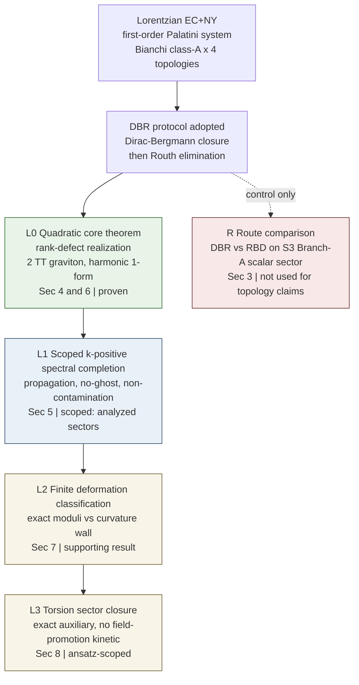

# DPPUv7-paper07: Dirac-before-Routh Constrained Spectra in Bianchi Class-A Einstein–Cartan–Nieh–Yan Cosmologies

*Rank-Defect Kernels, Spectral Robustness, and Torsion-Sector Closure*

---

## Abstract

本稿では、Bianchi class-A 背景上の Lorentzian first-order Einstein–Cartan + Nieh–Yan（EC+NY）系を、Dirac-before-Routh（DBR）制約還元プロトコルによって解析する。Bianchi class-A 構造行列の rank-defect は数学的に既知の不変量であり、本稿の結果は、それが DBR 標準の二次制約摂動スペクトルにおいて残存する非伝播 scalar kernel として実現されることである。 $T^3$, $Nil^3$, $Sol^3$, $S^3$ の四背景にわたり、伝播 tensor sector は 2 つの正 kinetic な TT graviton 自由度を含み、scalar kernel の次元は

$$
d_{\rm zero}=\dim\ker n = 3-\mathrm{rank}(n)
$$

で与えられる。この分類は、DBR 制約代数・frame 不変性の検証・scalar/tensor スペクトル解析・解析対象 harmonic sector における $k>0$ スペクトル完成によって確立される。操作順を逆にした route では、 $S^3$ の検証済み scalar sector において Dirac 同値でない余分な scalar モードが出現する。この対照結果を踏まえ、以降の物理的主張はすべて DBR プロトコルに基づく。さらに、zero kernel の有限変形を finite Palatini branch 内で exact moduli と curvature wall に分類し、torsion ansatz scalars が NY-MAIN route の下で exact auxiliary に留まり、場への昇格によっても kinetic/gradient 項を獲得せず、上記の結果階層に影響を与えないことを示す。すべての結果は、明示された二次・harmonic-sector・homogeneous スコープの内部で確立される。

---

## 1. Introduction

### 1.1 Background and motivation

DPPU series では、Einstein–Cartan + Nieh–Yan 型 [8,9] の homogeneous geometry・torsion modes・topology response が段階的に整理されてきた [1–5]。paper05 [6] は Lorentzian $\alpha=0$ EC+NY baseline を $S^3$ closed-FLRW branch に構成し、paper06 [7] はこれを四 topology（ $S^3/T^3/Nil^3/Sol^3$ ）の isotropic reduced sector に拡張して、 $\chi$-controlled topology universality を確立した。

これらの先行研究は isotropic（等方）reduced sector の解析であった。本稿は次の段階として、**同じ Lorentzian EC+NY 系の homogeneous anisotropic 摂動スペクトル**を、四つの Bianchi class-A 背景上で **first-order（Palatini 型）変数のまま** 制約力学的に解析する。ここで本質的になるのが reduction route の問題である。first-order 系では補助的な接続変数を運動方程式で消去（Routh 型消去）してから制約解析を行うか、Dirac–Bergmann 閉包を先に完了してから消去するかという**操作順**が結果に影響しうることが一般論として知られている [13,21–23]。本稿では Dirac 閉包を先に行う **Dirac-before-Routh（DBR）プロトコル**を採用プロトコルとして宣言し（[Section 3](DPPUv7-paper07_sec03.md)）、その下で四 topology の制約付き摂動スペクトルを同一プロトコル下で分類する。

### 1.2 既知の結果 / 本稿の寄与

本稿の新規性の範囲を明確にするため、既知の結果と本稿の寄与を区別して述べる。

**既知の結果**:

- Dirac の制約 Hamiltonian 解析は標準的な枠組みである [10–12]。
- 制約閉包の前に変数を解いて消去する操作は、同値性が証明されない限り制約系を変えうる [13,21,22]。
- Bianchi class-A Lie 代数は構造行列の rank/signature データで分類される [14–16]。
- 本稿で扱う四 topology について、rank-defect / abelianization / $b_1$ のパターンは幾何学的に既知である [16,18–20]。
- $d_{\rm zero}=b_1$（ $\dim\ker n$ と first Betti number の一致）は既知の代数的事実である [16,18]。

**本稿の寄与**:

- DPPU 系の Lorentzian EC+NY first-order Palatini 設定において、DBR 制約摂動スペクトルが、既知の Bianchi rank-defect を残存する非伝播 scalar kernel として実現すること。
- 四 topology の比較が単一の共通 DBR プロトコルで実行され、伝播内容（2 TT graviton, 正 kinetic）が普遍で、非伝播 scalar kernel のみが topology 依存となること。
- 操作順を逆にした route（Routh-before-Dirac）を対照実験として保持すること。検証済みの $S^3$ scalar sector において route 依存の Dirac 非同値な余分モードが生じるため、物理的主張には用いない。
- 解析対象 harmonic sector における $k>0$ スペクトル完成・zero kernel の有限変形の分類・torsion/NY の検証により、DBR rank-defect kernel が（明示されたスコープ内で）homogeneous 二次打ち切りの副産物でないことを示すこと。

### 1.3 Main results

本稿の主結果を階層順に述べる。

1. **rank-defect の実現** DBR 標準の二次制約スペクトルにおいて、残存する非伝播 scalar kernel は既知の Bianchi class-A rank-defect を物理自由度解析側で実現する。階層は $S^3{:}0$ / $Sol^3{:}1$ / $Nil^3{:}2$ / $T^3{:}3$（Bianchi IX/VI₀/II/I, $\mathrm{rank}(n)=3/2/1/0$）。次元は SO(3) frame 不変であり、機構は DBR 制約代数の activation rank から導出される（[Section 4](DPPUv7-paper07_sec04.md)）。

$$
d_{\rm zero}=\dim\ker n = 3-\mathrm{rank}(n),
\qquad n^{ij}=\tfrac12\,\epsilon^{ikl}C^{j}{}_{kl}.
$$

2. **伝播内容の普遍性** 四 topology すべてで伝播自由度は 2 つの TT graviton であり、kinetic block は正定値である。
3. **スペクトル完成による頑健性** 上記の分類は、解析対象の harmonic sector における $k>0$ スペクトル完成（ $T^3/S^3$ endpoint control・ $Nil^3$ 閉形式 completion・ $Sol^3$ bulk gap + compact edge positive）の下で保持される（[Section 5](DPPUv7-paper07_sec05.md)）。
4. **zero kernel の実現** zero kernel は left-invariant harmonic 1-form（ $\ker n$ ）として実現される（[Section 6](DPPUv7-paper07_sec06.md)）。
5. **zero kernel の有限変形の分類（補助的結果）** zero kernel の有限変形は、finite Palatini branch / homogeneous minisuperspace の範囲で exact moduli と curvature wall に分類される: modulus/wall = $T^3$: 3/0, $Nil^3$: 1/1, $Sol^3$: 0/1, $S^3$: 0/0（[Section 7](DPPUv7-paper07_sec07.md)）。
6. **torsion sector の閉包（ansatz の範囲に限定）** NY-MAIN route と native torsion ansatz scalars（ $\eta, V$ ）の範囲で、reduced torsion sector は exact auxiliary に留まり、場 $\eta(x), V(x)$ への昇格でも検査済み native-action 判定において二次 kinetic/gradient 項を生成しない。したがって torsion/NY は §4–§7 の主結果のいずれにも影響を与えない（[Section 8](DPPUv7-paper07_sec08.md)）。
7. **route 比較（対照実験）** Routh 消去を Dirac 閉包より先に行う route は、検証済みの $S^3$ scalar sector で Dirac 非同値の余分 scalar モードを生む。対照 route として記録し（[Section 3](DPPUv7-paper07_sec03.md), [Appendix C](DPPUv7-paper07_appC.md)）、物理的主張には用いない。

なお $d_{\rm zero}$ には常に以下の限定を付す: (i) 新しい位相不変量として主張しない、(ii) 伝播する物理的 zero mode と同一視しない、(iii) DBR 二次制約スペクトルにおける残存する非伝播 scalar kernel である。

### 1.4 主張の階層とスコープ

本稿の主張は次の階層構造を持ち、各層で確立のスコープ（適用範囲）が異なる。

| 層 | 内容 | スコープ（適用範囲） |
|---|---|---|
| L0 | 二次核心定理（§1.3 の 1, 2, 4） | DBR 二次制約スペクトル内（定理） |
| L1 | $k>0$ スペクトル完成（§1.3 の 3） | 解析済み harmonic sector（ $Sol^3$ compact edge は代表的数値） |
| L2 | zero kernel の有限変形の分類（§1.3 の 5） | finite Palatini branch / homogeneous minisuperspace（補助的結果） |
| L3 | torsion sector の閉包（§1.3 の 6） | NY-MAIN route + ansatz scalars + 検査済み判定 |
| R | route 比較（§1.3 の 7） | 検証済み $S^3$ scalar sector（対照実験） |

**Figure 1** Claim hierarchy and DBR workflow. Lorentzian EC+NY first-order Palatini 系に DBR プロトコルを適用し、主結果を L0→L1→L2→L3 の階層で積み上げる。L0–L3 の物理的主張はすべて DBR 下で確立する。R（route 比較）は DBR 採用の対照根拠であり、以降の topology 主張には用いない。*Scope*: 図中の節番号は reader-order の本文参照。L2・L3・R は §1.4 の表どおりスコープ限定。

本稿は full nonlinear field-theory theorem・任意の非均質摂動に対する完全な PDE 閉包・torsional charge / localization に関する定理を主張しない。これらの境界は各節と [Appendix C](DPPUv7-paper07_appC.md)–[G](DPPUv7-paper07_appG.md) の scope and limitations 記載で明示する。

### 1.5 Relation to earlier DPPU papers and adjacent literature

paper06 [7] の isotropic reduced sector では、四 topology は admissibility pattern を変えず、topology 依存は scalar $\chi$ に局在した。本稿の anisotropic 摂動レベルでは、topology 依存は非伝播 scalar kernel の次元 $d_{\rm zero}$ に局在し、その値が構造行列の rank-defect で与えられる。両者は「topology 依存が代数的データに局在する」という同型の構造を、異なる sector で実現している。

隣接文献との関係: compact Bianchi モデルの global自由度（Teichmüller パラメータ）の勘定は Koike–Tanimoto–Hosoya らによって確立されている [19,24–26]。本稿の $d_{\rm zero}$ は **metric GR の global moduli ではなく**、first-order EC+NY 系の DBR 制約スペクトルにおける摂動 kernel であり、対象が異なる（[Section 7](DPPUv7-paper07_sec07.md) で finite moduli 数 $\ne d_{\rm zero}$ を示す）。両者の関係は [Section 9](DPPUv7-paper07_sec09.md) で論じる。Bianchi 摂動論の既存研究としては Bianchi I の gauge-invariant 摂動論 [27] がある。Poincaré gauge theory の制約解析における "constraint bifurcation / field activation" 現象 [30,31] と本稿の activation rank の関係は [Section 4.3](DPPUv7-paper07_sec04.md) で区別する。NY 項が正準解析で topological であることは既知であり [33–35]、本稿の torsion 節はこれを reduced 系で exact に実証する位置づけである。

### 1.6 Paper organization

- [Section 2](DPPUv7-paper07_sec02.md): Lorentzian EC+NY setup と Bianchi class-A 背景・構造行列・torsion ansatz の定義。
- [Section 3](DPPUv7-paper07_sec03.md): DBR reduction protocol の定義と route justification（対照実験の要約）。
- [Section 4](DPPUv7-paper07_sec04.md): 中心定理 — DBR 制約スペクトルにおける rank-defect realization。
- [Section 5](DPPUv7-paper07_sec05.md): Robustness I — $k>0$ スペクトル完成（伝播・no-ghost・非混入）。
- [Section 6](DPPUv7-paper07_sec06.md): zero kernel の harmonic 1-form 実現。
- [Section 7](DPPUv7-paper07_sec07.md): zero kernel の有限変形の分類（exact moduli vs curvature wall）。
- [Section 8](DPPUv7-paper07_sec08.md): Torsion/Nieh–Yan sector robustness。
- [Section 9](DPPUv7-paper07_sec09.md): Discussion and outlook。
- [Appendix A](DPPUv7-paper07_appA.md): conventions（Lorentzian 規約・ $n^{ij}$ 符号・ $S^3$ 正規化 $C=\epsilon$ ）。
- [Appendix B](DPPUv7-paper07_appB.md): native local action と DBR 計算検証。
- [Appendix C](DPPUv7-paper07_appC.md): route 比較と route-dependent discrepancy の詳細。
- [Appendix D](DPPUv7-paper07_appD.md): endpoint / spectral evidence と spectral verification summary。
- [Appendix E](DPPUv7-paper07_appE.md): harmonic form と Hessian kernel realization。
- [Appendix F](DPPUv7-paper07_appF.md): zero kernel 有限変形の branch data と minisuperspace closure。
- [Appendix G](DPPUv7-paper07_appG.md): torsion auxiliary exactness と field-promotion 判定。

---

## References

1. Muacca, "Topology-Dependent Phase Classification of Effective Potentials in Einstein-Cartan + Nieh-Yan Minisuperspace," Zenodo, 10.5281/zenodo.18213677 (2026).
2. Muacca, "Structural Robustness of Isotropic $S^3$ Vacua in Einstein-Cartan Minisuperspace via Chiral Equilibrium and Weyl Stability," Zenodo, 10.5281/zenodo.18815498 (2026).
3. Muacca, "Unified Geometric Landau EFT of Homogeneous $S^3\times S^1$ Minisuperspace in Einstein-Cartan + Nieh-Yan Theory," Zenodo, 10.5281/zenodo.19144481 (2026).
4. Muacca, "Homogeneous Three-Topology Comparison and Mode Dictionary in Einstein-Cartan + Nieh-Yan Theory: Geometric Structure of EC-Weyl Coupling," Zenodo, 10.5281/zenodo.19425147 (2026).
5. Muacca, "Euclidean Geometric Response Dictionary and Selection Rules for Four Thurston Geometries," Zenodo, 10.5281/zenodo.19775695 (2026).
6. Muacca, "Lorentzian Einstein-Cartan Minisuperspace with Nieh-Yan Torsion: Hamiltonian Branches, Pontryagin Diagnostics, and Weyl-Source Obstructions," Zenodo, 10.5281/zenodo.20084722 (2026).
7. Muacca, "Reduced-Sector $\chi$-Universality in Lorentzian EC+NY Minisuperspace: Topology-Robust Admissibility, P-Channel Diagnostics, and Reduced Vacuum Orbits," Zenodo, 10.5281/zenodo.20228881 (2026).
8. F. W. Hehl, P. von der Heyde, G. D. Kerlick, and J. M. Nester, "General relativity with spin and torsion: Foundations and prospects," Rev. Mod. Phys. **48**, 393–416 (1976), doi:10.1103/RevModPhys.48.393.
9. H. T. Nieh and M. L. Yan, "An identity in Riemann-Cartan geometry," J. Math. Phys. **23**, 373–374 (1982), doi:10.1063/1.525379.
10. P. A. M. Dirac, *Lectures on Quantum Mechanics* (Belfer Graduate School of Science, Yeshiva University, New York, 1964).
11. J. L. Anderson and P. G. Bergmann, "Constraints in covariant field theories," Phys. Rev. **83**, 1018–1025 (1951), doi:10.1103/PhysRev.83.1018.
12. M. Henneaux and C. Teitelboim, *Quantization of Gauge Systems* (Princeton University Press, Princeton, NJ, 1992).
13. J. M. Pons, "Substituting fields within the action: Consistency issues and some applications," J. Math. Phys. **51**, 122903 (2010), arXiv:0909.4151, doi:10.1063/1.3525242.
14. L. Bianchi, "Sugli spazi a tre dimensioni che ammettono un gruppo continuo di movimenti," Mem. Mat. Fis. Soc. Ital. Sci. **11**, 267 (1898).
15. G. F. R. Ellis and M. A. H. MacCallum, "A class of homogeneous cosmological models," Commun. Math. Phys. **12**, 108–141 (1969), doi:10.1007/BF01645908.
16. J. Milnor, "Curvatures of left invariant metrics on Lie groups," Adv. Math. **21**, 293–329 (1976), doi:10.1016/S0001-8708(76)80002-3.
17. W. P. Thurston, *Three-Dimensional Geometry and Topology, Volume 1*, edited by S. Levy (Princeton University Press, Princeton, NJ, 1997).
18. P. Scott, "The geometries of 3-manifolds," Bull. London Math. Soc. **15**, 401–487 (1983), doi:10.1112/blms/15.5.401.
19. A. Ashtekar and J. Samuel, "Bianchi cosmologies: the role of spatial topology," Class. Quantum Grav. **8**, 2191–2215 (1991), doi:10.1088/0264-9381/8/12/005.
20. C. G. Torre, "Cosmology, cohomology and compactification," Class. Quantum Grav. **21**, L73 (2004), arXiv:gr-qc/0402105, doi:10.1088/0264-9381/21/11/L01.
21. M. A. H. MacCallum and A. H. Taub, "Variational principles and spatially-homogeneous universes, including rotation," Commun. Math. Phys. **25**, 173–189 (1972), doi:10.1007/BF01877589.
22. R. S. Palais, "The principle of symmetric criticality," Commun. Math. Phys. **69**, 19–30 (1979), doi:10.1007/BF01941322.
23. N. Dadhich and J. M. Pons, "On the equivalence of the Einstein-Hilbert and the Einstein-Palatini formulations of general relativity for an arbitrary connection," Gen. Rel. Grav. **44**, 2337–2352 (2012), arXiv:1010.0869, doi:10.1007/s10714-012-1393-9.
24. T. Koike, M. Tanimoto, and A. Hosoya, "Compact homogeneous universes," J. Math. Phys. **35**, 4855–4888 (1994), arXiv:gr-qc/9405052, doi:10.1063/1.530819.
25. M. Tanimoto, T. Koike, and A. Hosoya, "Dynamics of compact homogeneous universes," J. Math. Phys. **38**, 350–368 (1997), arXiv:gr-qc/9604056, doi:10.1063/1.531853.
26. M. Tanimoto, T. Koike, and A. Hosoya, "Hamiltonian structures for compact homogeneous universes," J. Math. Phys. **38**, 6560–6577 (1997), arXiv:gr-qc/9705052; 関連: "Canonical structure of locally homogeneous systems on compact closed 3-manifolds of types $E^3$, Nil and Sol," Prog. Theor. Phys. **99**, 173 (1998), arXiv:gr-qc/9712069.
27. T. S. Pereira, C. Pitrou, and J.-P. Uzan, "Theory of cosmological perturbations in an anisotropic universe," JCAP **09** (2007) 006, arXiv:0707.0736, doi:10.1088/1475-7516/2007/09/006.
28. M. A. Rubin and C. R. Ordóñez, "Eigenvalues and degeneracies for $n$-dimensional tensor spherical harmonics," J. Math. Phys. **25**, 2888 (1984), doi:10.1063/1.526034.
29. L. Lindblom, N. W. Taylor, and F. Zhang, "Scalar, vector and tensor harmonics on the three-sphere," Gen. Rel. Grav. **49**, 139 (2017), arXiv:1709.08020, doi:10.1007/s10714-017-2303-y.
30. H.-J. Yo and J. M. Nester, "Hamiltonian analysis of Poincaré gauge theory scalar modes," Int. J. Mod. Phys. D **8**, 459–479 (1999), arXiv:gr-qc/9902032, doi:10.1142/S021827189900033X.
31. H.-J. Yo and J. M. Nester, "Hamiltonian analysis of Poincaré gauge theory: Higher spin modes," Int. J. Mod. Phys. D **11**, 747–780 (2002), doi:10.1142/S0218271802001998.
32. M. Blagojević and I. A. Nikolić, "Hamiltonian structure of the Poincaré gauge theory and the problem of gauge symmetries," Phys. Rev. D **62**, 024021 (2000), arXiv:hep-th/0006031.
33. G. Date, R. K. Kaul, and S. Sengupta, "Topological interpretation of Barbero-Immirzi parameter," Phys. Rev. D **79**, 044008 (2009), arXiv:0811.4496, doi:10.1103/PhysRevD.79.044008.
34. S. Mercuri, "From the Einstein-Cartan to the Ashtekar-Barbero canonical constraints, passing through the Nieh-Yan functional," Phys. Rev. D **77**, 024036 (2008), arXiv:0708.0037.
35. R. K. Kaul and S. Sengupta, "Topological parameters in gravity," Phys. Rev. D **85**, 024026 (2012), arXiv:1106.3027.
36. M. Li, H. Rao, and D. Zhao, "A simple parity violating gravity model without ghost instability," JCAP **11** (2020) 023, arXiv:2007.08038.
37. M. Li and H. Rao, "Ghost instability in the teleparallel gravity model with parity violations," Phys. Lett. B **834**, 137395 (2022), arXiv:2201.02357.
38. H. Kesten, "Symmetric random walks on groups," Trans. Amer. Math. Soc. **92**, 336–354 (1959), doi:10.1090/S0002-9947-1959-0109367-6.
39. R. Brooks, "The fundamental group and the spectrum of the Laplacian," Comment. Math. Helv. **56**, 581–598 (1981), doi:10.1007/BF02566228.
40. A. V. Bolsinov, H. R. Dullin, and A. P. Veselov, "Spectra of Sol-manifolds: arithmetic and quantum monodromy," Commun. Math. Phys. **264**, 583–611 (2006), arXiv:math-ph/0503046, doi:10.1007/s00220-006-1543-6.
41. K. Nomizu, "On the cohomology of compact homogeneous spaces of nilpotent Lie groups," Ann. of Math. (2) **59**, 531–538 (1954), doi:10.2307/1969716.
42. A. Hattori, "Spectral sequence in the de Rham cohomology of fibre bundles," J. Fac. Sci. Univ. Tokyo Sect. I **8**, 289–331 (1960).