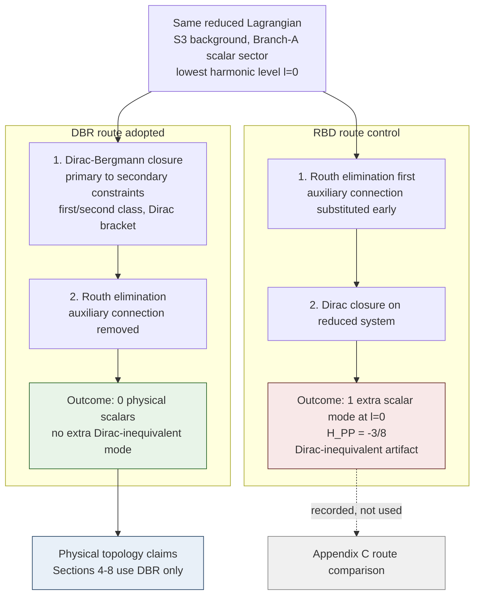

# DPPUv7-paper07 — Section 3: DBR Reduction Protocol and Route Justification

[← Section 2](DPPUv7-paper07_sec02.md) | [Section 4 →](DPPUv7-paper07_sec04.md)

---

## 3. DBR reduction protocol and route justification

### 3.1 The Dirac-before-Routh protocol

first-order EC+NY 系の位相空間は tetrad・接続とそれらの共役運動量からなり、多数の primary constraints を持つ。本稿の還元手続きは次の順序を**プロトコルとして採用**する。

> **DBR（Dirac-before-Routh）プロトコル**: (i) Dirac–Bergmann アルゴリズム [10–12] を完了する。すなわち primary constraints の consistency から secondary constraints を生成し、閉包後に first/second class を分類し、second class 対には Dirac bracket を構成する。(ii) その後にはじめて、補助変数（接続の非力学成分など）の Routh 型消去・縮約を行い、reduced スペクトルを提示する。

DBR は新しい原理ではなく、制約力学の標準手続きをこの系に忠実に適用したものである。逆順、すなわち補助的な接続変数を場の方程式で解いて作用に代入してから制約解析を行う route を本稿では **RBD（Routh-before-Dirac）** と呼ぶ。

### 3.2 Why the order matters: a recognized issue

作用レベルでの変数代入と運動方程式レベルでの代入が一般には可換でないことは確立された一般論である [13]。代入が安全なのは auxiliary variables（自身の方程式が代数的に解け、微分を含まない）に限られ、それ以外では同値性の証明が必要である。Bianchi 文脈でも、対称性を作用レベルで課す reduction の正当性が class A に限られること（class B では誤った場の方程式を与える）は古典的に知られており [21,22]、Palatini 形式と metric 形式の同値性自体が制約解析によって証明されるべき非自明な命題である [23]。本稿が DBR を標準とするのは、この既知の "Palatini reduction non-commutativity"（route 依存性）に対して制約同値性が保証される手続きの順序を選ぶということである。

### 3.3 対照実験

DBR の採用を実証的に裏づけるため、RBD route を**対照実験**として実行した。検証は $S^3$ 背景の Branch-A scalar sector で行った。結果は次のとおりである。

> 検証済みの $S^3$ Branch-A scalar sector において、補助接続変数を Dirac 閉包の前に消去すると、Dirac 同値でない余分な scalar モードが生じる。再計算では、DBR_KEEP_ALL が全 harmonic 代表で $N_{\rm phys}=0$ を返す一方、RBD の spatial-omega/full- $K$ Routh variants は $N_{\rm phys}=1/1/2$（ $l=0,1,\ge2$ ）を返す。最低 harmonic レベルでは同一の Branch-A local first-order Lagrangian から、DBR: 0 / RBD: 1 の不一致と $H_{PP}=-3/8<0$ が厳密に再現される。 $l\ge1$ の RBD extra count は route-level の gauge-breaking artifact として扱い、負符号の診断は $l=0$ に限定する（スコープの詳細は [Appendix C](DPPUv7-paper07_appC.md)）。

この不一致は **route-level** のものであり、物理的 instability ではない。本稿はこの結果から「RBD は一般に誤りである」という定理を主張しない。主張は次の一点に限る: **この系では route の同値性が成立しない事例が実在するため、以降の物理的 topology 主張はすべて DBR プロトコルにおいて行う。**

**Table 2** Route taxonomy（compact 版; 詳細は [Appendix C](DPPUv7-paper07_appC.md)）.

| route | 閉包と消去の順序 | $S^3$ Branch-A scalar sector の帰結 | status |
|---|---|---|---|
| DBR | Dirac 閉包 → Routh 消去 | 物理的 scalar 0（kernel は非伝播; [Section 4](DPPUv7-paper07_sec04.md)） | **adopted**（標準） |
| RBD | Routh 消去 → Dirac 閉包 | Dirac 非同値の余分 scalar モード（ $l=0$ で $H_{PP}=-3/8<0$; route-level） | 対照 route（対照実験として記録） |

**Figure 2** DBR vs RBD route comparison. 同一の Branch-A local first-order Lagrangian から、操作順のみを変えた二経路を並列に示す。DBR では物理的 scalar 自由度 0、RBD では Dirac 非同値の余分モードが再計算され、最低 harmonic レベルでは $H_{PP}=-3/8<0$ が確認される。*Scope*: 負符号の診断は $l=0$ に限定する。 $l\ge1$ の RBD extra count は route-level の gauge-breaking artifact として記録し、物理的 instability とは扱わない。

### 3.4 Scope declaration

以降の全節（[Section 4](DPPUv7-paper07_sec04.md)–[8](DPPUv7-paper07_sec08.md)）の主張は DBR プロトコル下の結果である。RBD route は [Appendix C](DPPUv7-paper07_appC.md) の route 比較詳細でのみ言及する。

---

[← Section 2](DPPUv7-paper07_sec02.md) | [Section 4 →](DPPUv7-paper07_sec04.md)
