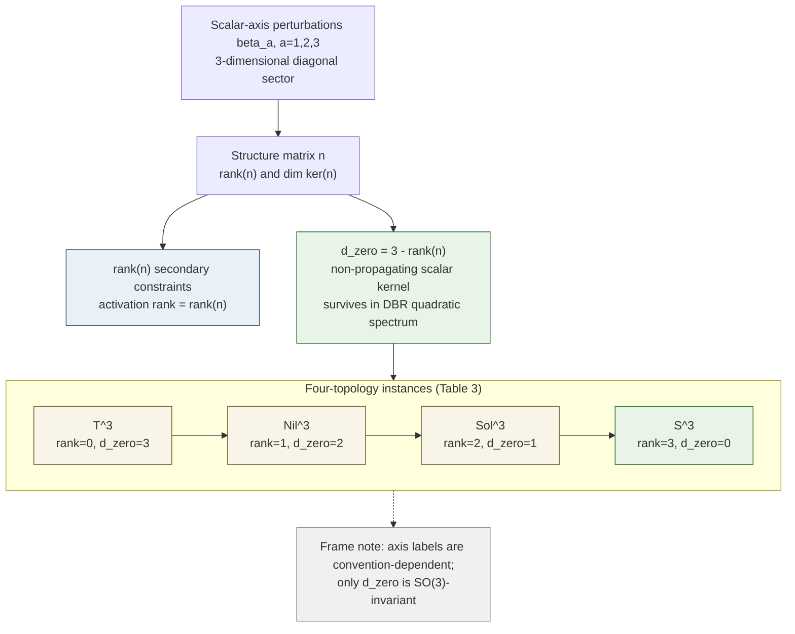

# DPPUv7-paper07 — Section 4: Rank-Defect Realization in the DBR Constrained Spectrum

[← Section 3](DPPUv7-paper07_sec03.md) | [Section 5 →](DPPUv7-paper07_sec05.md)

---

## 4. Rank-defect realization in the DBR constrained spectrum

### 4.1 Theorem statement

rank-defect $\dim\ker n$ 自体は Bianchi class-A 代数の既知の不変量である [15,16]。以下の定理は、その**実現**に関するものである。すなわち、DBR 標準の EC+NY 制約摂動スペクトルにおいて残存する scalar kernel が、ちょうどこの既知の不変量で与えられることを述べる。

> **Theorem 1（rank-defect realization）.**
> Bianchi class-A 背景（ $T^3, Nil^3, Sol^3, S^3$ ）上の Lorentzian first-order EC+NY 系に DBR プロトコルを適用した二次制約摂動スペクトルは、各 topology について以下を満たす。
>
> (i) **伝播 sector**: 物理的伝播自由度は 2 つの transverse-traceless（TT）graviton であり、その kinetic block は正定値である。
>
> (ii) **scalar kernel**: scalar（diagonal/axis）sector で Dirac 閉包後に残存する非伝播モードの次元は
>
> $$
> d_{\rm zero}=\dim\ker n = 3-\mathrm{rank}(n)
> $$
>
> で与えられる。階層は $S^3{:}0$ / $Sol^3{:}1$ / $Nil^3{:}2$ / $T^3{:}3$ である。
>
> (iii) **frame 不変性**: $d_{\rm zero}$ は空間 frame の SO(3) 回転に対して不変である。

**定理の適用範囲**:

- $d_{\rm zero}$ を新しい位相不変量として主張しない（rank-defect は既知 [16]; 本定理の内容はその制約力学的実現である）。
- kernel モードを伝播する物理的 zero mode と同一視しない。これは DBR 二次制約スペクトルにおける残存する非伝播 scalar kernel（運動項と対をなさない方向）であり、higher-order での運命は [Section 7](DPPUv7-paper07_sec07.md) で finite Palatini branch のスコープ内で分類する。
- 主張は class A に限る（class B への拡張は行わない）。

### 4.2 Four-topology instances

**Table 3** Four-topology instances of Theorem 1（evidence 列の tier 定義は [Appendix D](DPPUv7-paper07_appD.md)）。

| topology | Bianchi | $\mathrm{rank}(n)$ | $d_{\rm zero}$ | $b_1$ | TT graviton | zero-mode evidence | TT/propagation evidence（ $k>0$ ） |
|---|---|---:|---:|---:|---|---|---|
| $T^3$ | I | 0 | 3 | 3 | 2 (正 kinetic) | full- $k$ endpoint | full- $k$ Fourier $\|k\|^2$（閉形式） |
| $Nil^3$ | II | 1 | 2 | 2 | 2 (正 kinetic) | full-spectral scalar（整合） | 解析済み harmonic sector における closed-form spectral completion: toroidal ∪ Heisenberg tower $2\pi\|k\|(2N{+}1)$（閉形式/解析的）＋ matrix harmonic closure $d(M)=2$ |
| $Sol^3$ | VI₀ | 2 | 1 | 1 | 2 (正 kinetic) | full-spectral scalar（bulk に正 gap） | bulk gap $2\|pq\|$（全ラベル, 解析的 bound）＋ compact edge $\lambda_1>0$（代表的数値）＋ $d(M)=2$ |
| $S^3$ | IX | 3 | 0 | 0 | 2 (正 kinetic) | endpoint（全 $l$ で不在） | $l$-symbolic 全 $l\ge2$（閉形式） |

zero-mode の出現「軸」は構造行列の kernel 方向に対応する: $Sol^3$ では単一の特異軸（ $n$ の zero 固有方向）、 $Nil^3$ では 2 軸、 $T^3$ では全 3 軸（flat degeneracy）、 $S^3$ では存在しない。軸の名称（どの座標軸か）は frame 規約依存であり、frame 不変なのは kernel の次元のみである。

### 4.3 Mechanism: activation rank of the constraint algebra

Theorem 1(ii) の機構は、scalar-axis 摂動をベクトル $\boldsymbol\beta\in\mathbb R^3$（成分 $\beta_a$, $a=1,2,3$）として置き、DBR consistency 条件が線形写像

$$
\mathcal A_n:\ \boldsymbol\beta \longmapsto \text{（secondary activation 成分）}
$$

を与えることから始まる。class-A Milnor frame では、構造定数と構造行列の formal structure map として

$$
\mathcal A_{\rm form}=n
$$

が成り立つ。ただし、この恒等式だけを DBR activation の物理的根拠とはしない。DBR activation としての意味は、[Appendix B](DPPUv7-paper07_appB.md) §B.2 の scalar-axis DBR closure audit により確認する。

**Proof skeleton（Theorem 1(ii)）.**

1. scalar-axis sector の二次 Lagrangian に対して DBR 閉包を実行し、primary preservation、secondary generation、constraint Poisson matrix rank、first/second class split から、各 scalar axis が活性化されるかを判定する。
2. 四 topology × 三 scalar axis の audit では、engine-derived activation matrix の rank が $\mathrm{rank}(n)$ と一致する。したがって活性化する独立 secondary constraint の数は $\mathrm{rank}(\mathcal A_{\rm DBR})=\mathrm{rank}(n)$（**activation rank**）。
3. 未活性方向は $\ker n$ であり、次元は $3-\mathrm{rank}(n)=d_{\rm zero}$。
4. $\ker n$ 方向には TT kinetic block と対をなす運動項が発生しない（scalar-axis Hessian の kernel と一致; [Section 6](DPPUv7-paper07_sec06.md)）。よって残存モードは propagating zero mode ではなく **nonpropagating scalar kernel** である。

この主張は任意の class-A 構造定数に対する一般 symbolic DBR theorem ではなく、本稿で扱う四つの class-A 背景に対する DBR closure audit である。formal identity $\mathcal A_{\rm form}=n$ は記法・構造写像の確認として併記し、DBR activation としての主証拠は `script/scripts/paper07/rank_defect_activation_witness.py` が出力する axis-by-axis closure rows に置く。

**用語に関する注**: Poincaré gauge theory の制約解析では、非線形制約に起因する "constraint bifurcation" や "field activation" 現象が知られている [30,31]。本稿の activation rank はこれらと異なり、**線形（二次作用）レベルの secondary constraint 活性化次元が構造行列の rank に厳密に一致する**という代数的命題である。

### 4.4 Frame invariance

**解析的証明**： 空間 frame の SO(3) 回転 $R$ の下で構造行列は合同変換

$$
n \longmapsto R\,n\,R^{\mathsf T}
$$

を受ける。rank と $\dim\ker n$ は相似変換だけでなくこの合同変換でも保存される。したがって $d_{\rm zero}=3-\mathrm{rank}(n)$ は frame 不変である。一方、 $\ker n$ の基底ベクトル（軸名）は $R$ で回転するだけであり、物理量ではない。

**数値による補助検証**： 上記を (a) ランダム SO(3) 回転、(b) 回転後の構造定数からの $n$ 再構成という二重経路で確認した（[Appendix B](DPPUv7-paper07_appB.md) §B.4）。すべての検査で kernel 次元が保存された。

### 4.5 Cross-check: $d_{\rm zero}=b_1$（not primary）

class-A 代数では $\dim\ker n=\dim(\mathfrak g/[\mathfrak g,\mathfrak g])$ であり、対応する compact 商の first Betti number $b_1$ に一致する。この同型（left-invariant 代表による Lie 環コホモロジー ↔ compact 商の de Rham コホモロジー）は、nilmanifold については Nomizu [41]、completely solvable な solvmanifold については Hattori [42] による（ $Sol^3$(VI₀) は completely solvable=type R なので後者が適用され、 $d_{\rm zero}=b_1=1$ と整合する）。この一致は Theorem 1 の**独立な cross-check** であり、幾何学的に既知の対応である。本稿はこれを定理の主根拠としては用いない（主根拠は §4.3 の activation rank 導出である）。kernel の幾何学的実現は [Section 6](DPPUv7-paper07_sec06.md) で示す。

### 4.6 What remains after the quadratic theorem

Theorem 1 は二次オーダーの命題である。残る自然な問いは二つある: (a) この分類は非均質モード（ $k>0$ ）で変更されないかについては[Section 5](DPPUv7-paper07_sec05.md)で、(b) kernel 方向は有限変形で flat 方向（moduli）か、それとも壁に遮られるかについては[Section 7](DPPUv7-paper07_sec07.md)で述べる。

---

**Figure 3** Rank-defect mechanism and four-topology ladder. scalar-axis 摂動 $\beta_a$ に対する consistency 条件は構造行列 $n$ を通じて secondary constraints を生成する。 $\mathrm{rank}(n)$ 本の image 方向が活性化（activation rank）し、 $\ker n$ の $d_{\rm zero}=3-\mathrm{rank}(n)$ 方向が非伝播 scalar kernel として残存する。四 topology では $T^3{:}3$ / $Nil^3{:}2$ / $Sol^3{:}1$ / $S^3{:}0$ の階層をなす。*Scope*: 軸名は frame 規約依存であり、不変なのは kernel 次元のみ（§4.4）。

---

[← Section 3](DPPUv7-paper07_sec03.md) | [Section 5 →](DPPUv7-paper07_sec05.md)
