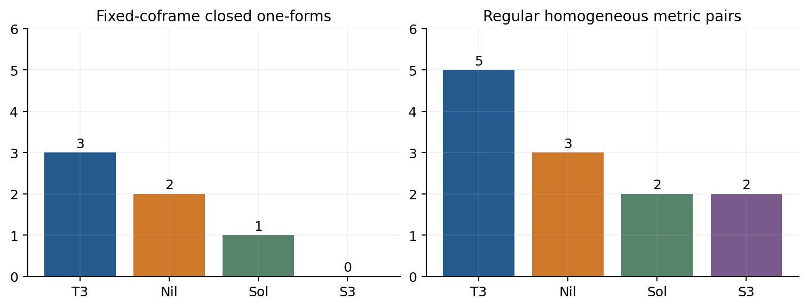

# 5. 正則斉次拘束と静的トーラス

式(H-03)。

$$
\begin{aligned}(A_k)^i{}_j&=n_{iz}\epsilon_{zkj},\qquad \mathcal L_\beta g=\beta^k(A_k^Tg+gA_k),\\
J_k&=\mathrm{tr}\bigl[\pi(A_k^Tg+gA_k)\bigr],\\
\lbrace J_i,F\rbrace &=0,\qquad \lbrace J_i,J_j\rbrace =-\epsilon_{ijk}n_kJ_k\quad(n=\mathrm{diag}(n_1,n_2,n_3)).\end{aligned}
$$

標準のsymplectic形式はΩ=Σᵢⱼδπⁱʲ∧δgᵢⱼであり、lapse・shiftのprimaryを除くとFと独立なJが第一級拘束を生成する。内部Lorentz方向はtorsionを解いた後に計量表示へ商を取った方向である。離散的な商の自己同型を連続gaugeとして差し引かない。

式(H-04)。

$$
r=\mathrm{rank}\thinspace dJ,\qquad \mathrm{rank}\thinspace d(F,J)=r+1,\qquad N_{\rm hom}=6-r-1.
$$

式(H-04)は拘束面上の正則な開いた層での局所計数である。付録Cでは非零minorと拘束面上の代表を示す。Jの最大独立数はAの線形包から上限が得られ、代表点のminorがその上限を実現する。退化層はこの式の仮定を個別に確認する必要がある。

| 幾何 | momentum rank | 全拘束rank |
| --- | --- | --- |
| T³ | 0 | 1 |
| Nil | 2 | 3 |
| Sol | 3 | 4 |
| S³ | 3 | 4 |

pair数5/3/2/2は、指定した固定商の全対称斉次計量という有限次元系の局所数である。時空の各点の重力偏極数、任意の格子のTeichmüller次元、各背景の零振動数の数ではない。閉1形式の3/2/1/0とは対象も数値も異なる。

指定coframeの閉1形式次元と、正則拘束層の斉次pair数。静的torusは後者の正則層に属さない。

## 静的torusの特異性

Paper06 §5・付録Dで得た斉次混合錐と厳密族を、本稿のHamiltonian拘束Fの特異層として位置付ける[paper6](REFERENCES.md#paper6)。第6–7節では、ここへ非零Fourier成分を加えた場合を調べる。

n=0、π=0ではFはmomentumの二次式でdF=0となる。二次作用のlapse方程式だけを見ると六つのmetric pairが残るが、元の非線形Hamiltonian拘束の二次係数は以下を要求する。Hの一次体積速度をh、tracefree部分をΣとする。

式(T-01)。

$$
K=\varepsilon(hI+\Sigma)+O(\varepsilon^2),\qquad \mathrm{tr}\Sigma=0,\qquad \mathrm{tr}(\Sigma^2)=6h^2.
$$

この錐は線形空間ではない。pure-scale切断はh=0を要求するが、shapeを同時に動かす非自明な接方向は存在する。拘束p_q²=0をp_q=0へ置き換えると微分とgauge生成子を変えるので、正則化として同一視しない。

式(T-02)。

$$
\begin{aligned}g_{ii}(\tau,\varepsilon)&=q_0^2(1+3\varepsilon h\tau)^{2p_i},\quad p_i=\frac13+\frac{\sigma_i}{3h},\\
\sum_i\sigma_i&=0,\quad\sum_i\sigma_i^2=6h^2,\quad\sum_ip_i=\sum_ip_i^2=1.\end{aligned}
$$

h≠0の場合、式(T-02)は1+3εhτ>0の区間で厳密な真空解であり、そのε微分が錐の方向を実現する。一般の対称Σは一定の直交行列による行列表示に戻せる。h=0ではΣ=0であり、一定計量の変形が残る。この明示的な斉次実現は、第7節の空間依存波に対する既知定理の適用とは別の構成である。

静的flat torusの計量族は局所的にSPD(3)の六次元、固定体積では五次元である。整数格子の離散同定は残る。この族ではπ=0なのでsymplectic形式の引戻しは零だが、族全体がgauge方向という意味ではない。

Paper04の閉1形式の次元とPaper06のframe比較は、ここでの斉次切断を指定する幾何データとして用いる[paper4](REFERENCES.md#paper4), [paper6](REFERENCES.md#paper6)。その次元から還元されたmetric系のkernelを求めるには、摂動場への写像と拘束・gauge商との対応が別に必要となる。既出の幾何結果と本稿の規格化の対応を付録Eにまとめる。

## S³ Taub点の線形rank例外

BF-01のS³ Taubでは、斉次momentum rankは2、Hamiltonianを含むrankは3である。軸U(1)の対称性により一般正則層のrank 3、4より低く、線形gauge商は3対を持つ。これはH-04の一般正則層の2対に代わる結果ではない。KIDの二次条件が残るため、線形商を非線形の滑らかな物理位相空間と同一視しない。

Taub族のℓ,m接方向は一つの非退化な線形pairを作り、背景の時間変位はpure gaugeである。非斉次の低ラベルにも別のKID例外が現れるため、第6節で表現重複度とともに数える。

[論文の入口](README_ja.md) / [参考文献](REFERENCES.md)
