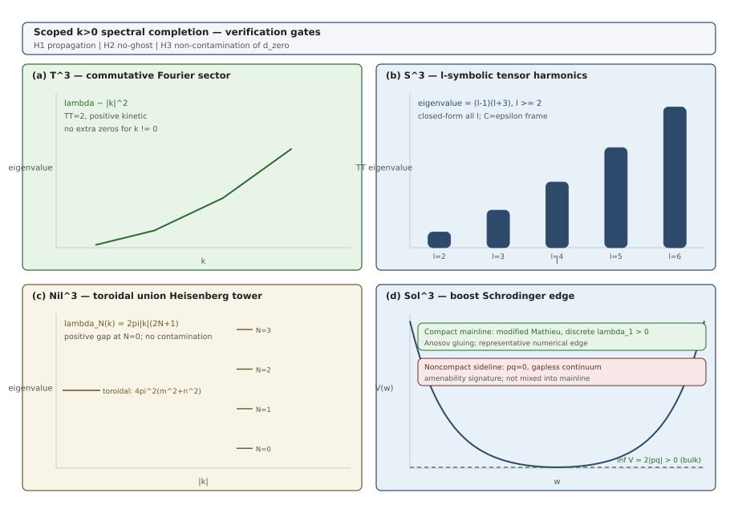

# DPPUv7-paper07 — Section 5: Robustness I — Scoped $k>0$ Spectral Completion

[← Section 4](DPPUv7-paper07_sec04.md) | [Section 6 →](DPPUv7-paper07_sec06.md)

---

## 5. Robustness I: scoped $k>0$ spectral completion

本節では Theorem 1 の分類が非均質モードで変更されないことを、**解析対象の harmonic sector における $k>0$ スペクトル完成**として示す。検証は次の operational definition で構成する:

- **H1（伝播）**: 解析ラベルで TT propagation operator が正であること（ $k>0$ で 2 TT が伝播し、分散が正）。
- **H2（no-ghost）**: TT kinetic Hessian が全ラベルで正定値であること。
- **H3（非混入）**: 解析済み $k>0$ sector が $d_{\rm zero}=3-\mathrm{rank}(n)$ に追加の normalizable physical zero を持ち込まないこと。

H1–H3 は full field-theory spectral theorem ではなく、解析済み harmonic sector に限定した頑健性基準である。

### 5.1 Endpoint controls: $T^3$ and $S^3$

四 topology 梯子の両端（ $d_{\rm zero}=3$ と $0$ ）はスペクトルが既知であり、手法の cross-check を兼ねる。

- **$T^3$（H1–H3 の proof-like 導出）**: 可換 Fourier 展開で TT spatial operator は以下の通りで、 $k\ne0$ では $\lambda_{T^3}>0$（H1）。kinetic block は正定値（H2）。 $k=0$ は flat degeneracy の endpoint/gauge locus として分離し、H3 の $k>0$ 主張には含めない。

$$
\lambda_{T^3}(\boldsymbol k)=|\boldsymbol k|^2.
$$

- **$S^3$（同様）**: tensor harmonics [28,29] により TT 固有値は以下の通りであり、 $l\ge2$ で $\lambda_{S^3}>0$（H1–H2）。scalar zero は全 $l$ で不在（ $l$ -symbolic; H3）。 $l=0,1$ は endpoint/gauge/non-dynamical として分類済み。（[Appendix A](DPPUv7-paper07_appA.md)）

$$
\lambda_{S^3}(l)=(l-1)(l+3)\qquad(C=\epsilon\ \text{frame})
$$
  

### 5.2 $Nil^3$: closed-form spectral completion（解析済み harmonic sector）

$Nil^3$（Heisenberg 群の compact 商）では、解析対象の harmonic sector が**二系列**に分解する:

- **toroidal sector**（ $k=0$ ）:

$$
\lambda_{\rm tor}(m,n)=4\pi^2(m^2+n^2),\qquad (m,n)\ne(0,0)\ \Rightarrow\ \lambda_{\rm tor}>0.
$$

- **Heisenberg sector**（ $k\ne0$ ）: 非可換性により Landau 型の塔をなし、最低段 $N=0$ でも $2\pi|k|>0$（正 gap）。

$$
\lambda_{\rm Heis}(k,N)=2\pi|k|\,(2N+1),\qquad N=0,1,2,\dots
$$

両系列で H1–H2 が成立し、正 gap により H3（追加 physical zero なし）が従う。matrix harmonic closure（TT: $d(M)=2$、spin-1: $d(M)=0$）とも整合する（[Appendix D](DPPUv7-paper07_appD.md)）。本稿ではこの結果を「解析済み harmonic sector における closed-form spectral completion」と呼ぶ。

### 5.3 $Sol^3$: bulk gap and the compact edge

$Sol^3$ の非可換 sector は boost 型 harmonic でラベルされ、reduced spatial operator は 1 次元 Schrödinger 型

$$
-\frac{d^2}{dw^2}+V(w),\qquad
V(w)=q^2 e^{2w/R}+p^2 e^{-2w/R}
$$

に帰着する（ $p,q$ はラベル）。本節では **bulk** と **compact edge** についてそれぞれ述べる。

- **bulk（ $pq\ne0$; ）**: 

$$
V(w)\ge 2|pq|,\qquad \text{等号は } |q e^{w/R}|=|p e^{-w/R}|\ \text{で達成}.
$$

したがって $\inf V=2|pq|>0$（解析的 bound, 全ラベル）で H1–H3 が成立する。

- **compact edge（代表的数値に限定）**: physical $Sol^3$ は hyperbolic gluing $A\in SL(2,\mathbb Z)$ の torus bundle（Anosov mapping torus）であり、各 sector は両側 confining な modified Mathieu 型になる [40]。代表 gluing parameter に対する有限差分 Sturm–Liouville witness で最低固有値 $\lambda_1>0$ を確認する。これは all-Anosov closed-form theorem ではなく、代表的数値に留める（`script/scripts/paper07/spectral_completion_witness.py`）。

なお、 $pq=0$ では $\inf V=0$ （非コンパクト）の gapless continuum が存在する（amenability 署名 [38,39]）。こちらについては正規化可能 zero とは呼ばず、compact edge とは別である。

### 5.4 No-ghost across all labels

TT kinetic Hessian は全 topology で

$$
K=\mathrm{diag}\!\left(\frac{2q^3}{N}\right)
$$

の形にラベル非依存（ $\partial K/\partial k=0$ ）で与えられ、正定値である。したがって no-ghost は解析済みの全ラベルに及ぶ。

なお、minisuperspace の no-ghostについては独立した検証として[Section 7](DPPUv7-paper07_sec07.md)で述べる。

### 5.5 Non-contamination of $d_{\rm zero}$

以上より、解析済みの全 harmonic sector で bulk gap が正であるため、 $k>0$ スペクトル完成は $d_{\rm zero}=3-\mathrm{rank}(n)$ に追加の物理的 zero を持ち込まない。homogeneous な $d_{\rm zero}$ の勘定と、full spectral の物理的自由度主張とは異なるレベルの命題であり、本節が示したのは前者が後者によって変更されないことである。

### 5.6 NY-inhomogeneous note

NY 項の $O(\delta^2)$ 密度は、解析済みの spectral sector においても bulk では rank に寄与しない。この事実は [Section 8](DPPUv7-paper07_sec08.md) で詳述する。

### 5.7 Evidence tiers

| tier | 意味 | 本節での該当 |
|---|---|---|
| 閉形式 | 閉形式・symbolic 全ラベル | $T^3$ full- $k$, $S^3$ $l$-symbolic, $Nil^3$ tower |
| 解析的 bound | 解析的・全ラベル（閉形式でない bound 含む） | $Sol^3$ bulk gap $2\|pq\|$ |
| 代表的数値 | 数値・代表ラベル | $Sol^3$ compact edge $\lambda_1$（representative） |

spectral verification summary の全表は [Appendix D](DPPUv7-paper07_appD.md) にまとめる。

---

**Figure 4** Scoped $k>0$ spectral completion map. 四 topology の解析済み harmonic sector と検証基準（伝播・no-ghost・非混入）の対応を示す。**(a) $T^3$**: 可換 Fourier sector、 $|k|^2$ 分散。**(b) $S^3$**: $l$-symbolic tensor harmonics、 $(l-1)(l+3)$。**(c) $Nil^3$**: toroidal sector と Heisenberg Landau 塔 $2\pi|k|(2N{+}1)$ の和。**(d) $Sol^3$**: boost Schrödinger ポテンシャル $V(w)$；コンパクト主線（modified Mathieu、離散 $\lambda_1>0$）と非コンパクト副線（ $pq=0$ gapless continuum）を分離表示。生成: `script/scripts/visualize/fig04_spectral_completion_map.py`。*Scope*: 本図は解析済み harmonic sector に限定；任意の非均質摂動に対する full PDE 定理ではない。

---

[← Section 4](DPPUv7-paper07_sec04.md) | [Section 6 →](DPPUv7-paper07_sec06.md)