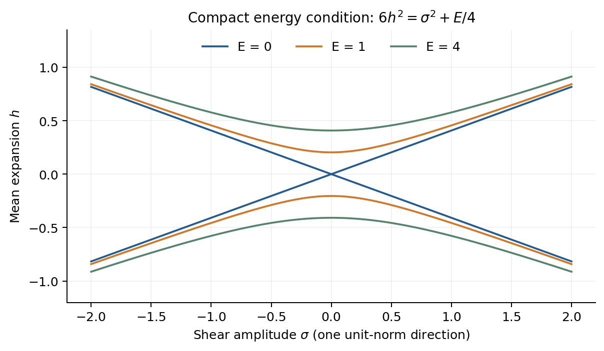

# 7. コンパクト条件と局所可積分性

## Flat torusの四条件と既知定理

Paper06の斉次体積速度h、tracefree shear Σに平均零のTT場γを加え、元の拘束を二次まで展開して空間積分する。時間並進と三つの空間並進に対する条件は次となる。

式(W-03)。

$$
\begin{aligned}6h^2&=\mathrm{tr}(\Sigma^2)+\frac14\left\langle\dot\gamma_{ij}^2+q_0^{-2}(\partial_a\gamma_{ij})^2\right\rangle,\\
0&=\left\langle\dot\gamma_{ij}\partial_a\gamma_{ij}\right\rangle\quad(a=1,2,3).\end{aligned}
$$

固定flat torusにはこの四つ以外のKIDがない。境界のないCMC Cauchy面上の滑らかな周期線形真空データについて、AMM1982 Theorem 3.3を適用すると、W-03は背景を通る局所的な厳密真空解族の接方向となるための必要十分条件である。付録Dに関数空間、KID、定理の錐との規格化対応を示す。

十分性の根拠は既知定理であり、平均条件の有限検算だけではない。高次補正に新しい空間harmonicを許す。二端点境界値問題、全時間の正則性、非線形安定性までは述べない。LC接続で持ち上げると同じ非退化EC＋定数完全NYの局所解族となる。

γ=0では斉次錐T-01へ戻る。h=Σ=0のpure-wave方向は正energyにより排除されるが、体積速度を持つ混合方向には非自明な接方向がある。standing wave A cos x cos tはE=A²、並進charge零でh²=A²/24。traveling wave A cos(x−t)はE=2A²、Pₓ=−A²で、反対向きの波などによる相殺が必要となる。

W-03のenergy条件。並進chargeの三条件も満たすと、明示したflat torusの仮定内で局所可積分性の必要十分条件となる。

## 定在波の明示二次補正

q₀=1、周期2πで、次の計量の指数をε(A₁,B₁,P₁)+ε²(A₂,B₂,P₂)と展開する。

式(W-04)。

$$
\begin{aligned}
ds^2&=e^{2\mathcal A}(-dt^2+dx^2)+e^{2\mathcal B+2\mathcal P}dy^2+e^{2\mathcal B-2\mathcal P}dz^2,\\
A_1&=B_1=ht,\qquad P_1=\frac a2\cos x\cos t,\qquad h^2=\frac{a^2}{24},\\
A_2&=\frac{h^2t^2}{2}+\frac{a^2}{32}(1-\cos2t-\cos2x),\\
B_2&=-h^2t^2-\frac{a^2}{64}\cos2x\cos2t,\\
P_2&=\frac{ha}{2}(\sin t-t\cos t)\cos x.
\end{aligned}
$$

膨張・収縮の両符号で全Ricci成分の一次・二次係数が消える。零mode・元の波数・二倍波数を残しており、二次式自体を有限振幅の厳密解とは呼ばない。非平行な二つの定在波についてはh²=(a²+b²)/24とし、生成する13波数の全sourceと補正を付録Dの方法で構成する。時間多項式・共鳴項も保持し、固定有限時間でO(ε³)の残差を得る。

## Nilのcentral条件

BF-01の各曲がった背景はCMCで、 $`K_{ij}K^{ij}>0`$ である。KID lapseはコンパクト積分恒等式から零となる。固定商へ降りる空間Killing場を数えるとNilはcentralの1本、Solは0、S³ Taubは4本となる。Nilのm=0 sectorではcentral chargeが恒等的に零であるが、m≠0では次の条件が非自明となる。

式(K-01)。

$$
\mathcal Q_Z=-2\sum_{m>0,r,L}\mu\thinspace\mathrm{Im}(\Pi^\dagger Q)=0,
\qquad \mu=\frac{m}{2\pi}.
$$

実場の共役sectorは寄与を相殺せず加算する。条件は全blockの和に課し、各blockのchargeを個別に零とする必要はない。L=2でQ=(1,0)、Π=(i,0)なら線形拘束を満たしてもcharge=2μとなる。charge零の非自明な線形例もあるが、十分性定理の適用や二次Einstein補正はここでは示していない。

## SolのKIDと周期再構成

固定Sol商には大域KIDがないため、flat T³の四条件やNilのcentral条件を一般orbitに追加しない。fiber非依存Gowdy表示の周期再構成にはKG-03の二次の平均補正 $`\langle\delta p_P^{(2)}\rangle`$ が寄与する。その補正を零に固定した一次場だけのsource条件を、一般fiber依存系に共通するKID obstructionとみなさない。非線形の積は零modeや他orbitを生成し、その持ち上げは別問題である。

## S³ Taubの四条件

式(K-02)。

$$
\mathcal Q_X=\int_{S^3}p^{ij}\mathcal L_Xh_{ij}\thinspace d\mu=0,
\qquad X\in\mathfrak{su}(2)\oplus\mathfrak u(1).
$$

左SU(2)の三条件は係数の左添字に作用する。軸U(1)では右添字の微分に加えtensor frameの回転を含める。j=0とj=1の随伴kernelはこれらのKIDに対応する。局所線形拘束と四つの二次必要条件を満たすj=3/2の有限時間例を得るが、任意データの非線形持ち上げ、全j一様評価、horizon近傍の安定性までは示さない。

## 条件の適用範囲

| 背景 | 大域KID数 | 本稿での結論 |
| --- | --- | --- |
| 固定flat T³ | 4 | 仮定内で局所可積分性に必要十分 |
| Nil LRS | 1 | central chargeの二次必要条件 |
| 固定Sol | 0 | KID障害なし。十分性は未適用 |
| S³ Taub | 4 | 四つの二次必要条件 |

[論文の入口](README_ja.md) / [参考文献](REFERENCES.md)
