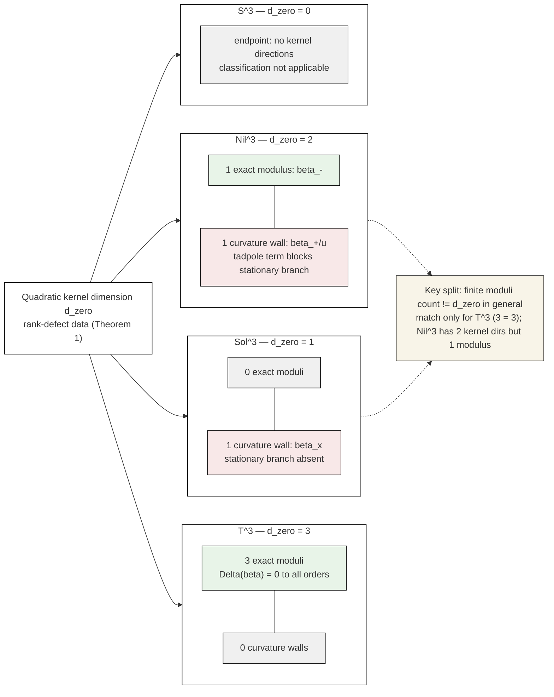

# DPPUv7-paper07 — Section 7: Finite Fate of the Zero Kernel

[← Section 6](DPPUv7-paper07_sec06.md) | [Section 8 →](DPPUv7-paper07_sec08.md)

---

## 7. Finite fate of the zero kernel

二次オーダーで $d_{\rm zero}$ 本の非伝播 kernel 方向が見つかった後の自然な問いは、「これらは有限変形でも flat な方向（moduli）か、それとも有限振幅で壁に遮られるか」である。本節はこの問いに **finite Palatini branch / homogeneous minisuperspace のスコープ内で**答える。**本節は補助的結果であり、Theorem 1（二次定理）の一部ではない。**

### 7.1 Classification: exact moduli versus curvature walls

kernel 方向に沿った有限変形 $\beta\mapsto$ 有限値 に対し、background-adapted な static Palatini branch を再構成し、reduced energy density $\Delta(\beta)$ の有限展開（4 次まで symbolic）を検証した。結果は次の二分類である。

- **exact modulus**: $\Delta(\beta)=0$ が展開全次数で厳密に成立（flat 方向が有限変形でも持続）。
- **curvature wall**: $\Delta(\beta)$ に曲率由来の非零項（tadpole を含む）が発生し、stationary な有限変形 branch が存在しない。

**式レベルの要点（finite Palatini branch / homogeneous minisuperspace）.**

- **$T^3$**: 空間スカラー曲率は恒等的に消える。したがって任意の kernel 方向で $\Delta(\beta)\equiv0$（exact flat homogeneous branch）。
- **$Nil^3$ $\beta_-$**: Milnor frame で接ベクトル $(\tfrac12,-\tfrac12,0)$ に沿った branch では $\Delta(\beta_-)=0$（4 次まで残差 0; exact modulus）。closed-form branch 式は [Appendix F](DPPUv7-paper07_appF.md) §F.3。
- **$Nil^3$ $\beta_+/u$**: 接ベクトル $(-\tfrac12,-\tfrac12,1)$ 方向では reduced energy に曲率由来の線形項（tadpole）が残り、curvature wall。
- **$Sol^3$ $\beta_x$**: 接ベクトル $(\tfrac13,-\tfrac16,-\tfrac16)$ 方向では非零項が残り、stationary branch absent（curvature wall）。

**Table 4** Modulus/wall split（finite Palatini branch / homogeneous minisuperspace scoped）.

| topology | $d_{\rm zero}$ | exact moduli | curvature wall | 備考 |
|---|---:|---:|---:|---|
| $T^3$ | 3 | 3 | 0 | exact flat homogeneous moduli |
| $Nil^3$ | 2 | 1（ $\beta_-$ ） | 1（ $\beta_+/u$ ） | $\beta_-$ は exact modulus（4 次まで残差 0）、 $\beta_+$ は tadpole 付き wall |
| $Sol^3$ | 1 | 0 | 1（ $\beta_x$ ） | stationary branch absent |
| $S^3$ | 0 | 0 | 0 | $d_{\rm zero}=0$ endpoint（対象なし） |

**Figure 5** Modulus/wall split across four topologies. 二次 kernel 次元 $d_{\rm zero}$ と finite Palatini branch における exact modulus / curvature wall の対応を示す。 $d_{\rm zero}$ は rank-defect data として保持され、finite moduli 数と一般には一致しない（一致するのは $T^3$ のみ）。*Scope*: wall の確認は finite Palatini branch / homogeneous minisuperspace 内に限定；full nonlinear lift theorem ではない。

### 7.2 Minisuperspace DBR closure

この分類の整合性を、lapse・Hamiltonian constraint・DeWitt metric を含む lever-complete な homogeneous minisuperspace ansatz の DBR 閉包で検証した。結果: (i) Hamiltonian constraint を含めた閉包は成立し、(ii) trace-free tangent 方向の DeWitt norm は正（minisuperspace no-ghost）、(iii) homogeneous anisotropy の configuration 自由度は 2 である（検証データは [Appendix F](DPPUv7-paper07_appF.md)）。

### 7.3 Mandatory caveats

- **finite moduli 数は一般に $d_{\rm zero}$ と等しくない。** 一致するのは $T^3$（3=3）のみであり、 $Nil^3$ では $d_{\rm zero}=2$ に対し exact modulus は 1 である。 $d_{\rm zero}$ は rank-defect data（二次 kernel の次元）として保持され、finite modulus count とは別の量である。
- **wall の確認は finite Palatini branch 内で確立されており**、full nonlinear lift theorem・mass theorem ではない。time-dependent な full DBR 力学や非均質 sector への拡張は行っていない。
- **minisuperspace no-ghost は full field-theory no-ghost ではない**（後者の解析済みスコープは [Section 5](DPPUv7-paper07_sec05.md)）。
- branch 再構成における energy-density 展開による分類と停留点判定は異なる検査であり、[Appendix F](DPPUv7-paper07_appF.md) で区別して提示する。

### 7.4 Torsion non-contamination (corollary)

torsion modes（EH/AX/VT/MX）はこの modulus/wall split を変えない。これは torsion auxiliary shell が trivial であることの系であり（独立な力学検証ではない）、その精密化は [Section 8](DPPUv7-paper07_sec08.md) で行う。

---

[← Section 6](DPPUv7-paper07_sec06.md) | [Section 8 →](DPPUv7-paper07_sec08.md)